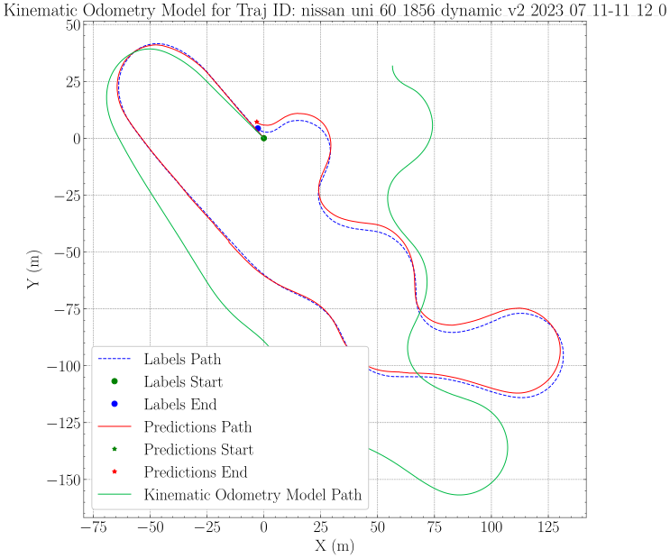
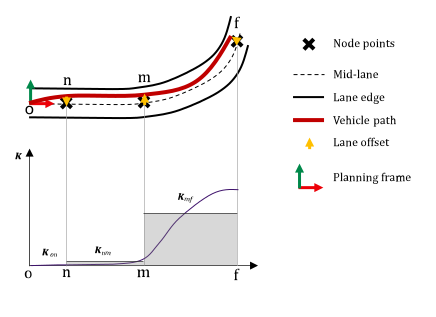
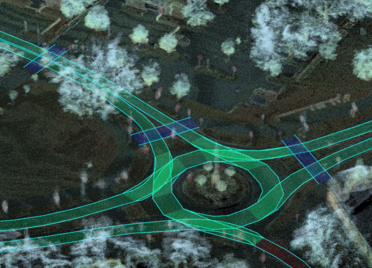

---
hide:
  - toc
---

# Dataset overview

The Vehicle Industry Research Center (JKK) at Széchenyi István University, Győr, Hungary, publishes datasets recorded with its research vehicles and sensor platforms. The datasets cover raw multi-sensor measurements, localization benchmarks, human-like driving behavior and HD maps. All data is provided for research and educational purposes. Each dataset page describes the content, format and recording setup, and explains how to access the data.

| ID | Purpose | Focus | Format |
|---|---|---|---|
| [`JKK_DATASET_01`](jkk_dataset_01) | Single vehicle | Raw sensor logs, point clouds | ROS 1 rosbag `.bag` |
| [`JKK_DATASET_02`](jkk_dataset_02) | Localization | Localization, sensor fusion, state estimation | ROS 2 `.mcap` |
| [`JKK_DATASET_03`](jkk_dataset_03) | HLB4AV | Human-like driving behavior | MATLAB `.mat` |
| [`JKK_DATASET_04`](jkk_dataset_04) | Mapping | HD map of various locations | Point cloud map `.pcd`, Lanelet2 `.osm` |

## `JKK_DATASET_01` - single vehicle measurement data

This dataset consists of measurement log files (ROS 1 rosbag), pointcloud files and additional scripts to access and edit these. The data is provided for research and educational purposes.

[Details](jkk_dataset_01){ .md-button .md-button--primary }

{ width="600" }

## `JKK_DATASET_02` - localization

This dataset consists of measurement log files (ROS 2 mcap) with additional scripts to access and edit these. The data is provided for research and educational purposes for localization, sensor fusion and state estimation benchmarking.

[Details](jkk_dataset_02){ .md-button .md-button--primary }

{ width="600" }

## `JKK_DATASET_03` - HLB4AV

This dataset contains the Human-like Behavior (HLB4AV) usecase data, in mat format.

[Details](jkk_dataset_03){ .md-button .md-button--primary }

{ width="600" }

## `JKK_DATASET_04` - mapping

This dataset contains the HD map data of the Széchenyi István University Campus (Győr, Hungary), captured on `2026-07-20`. The dataset includes a dense LiDAR point cloud map and a semantic Lanelet2 map.

[Details](jkk_dataset_04){ .md-button .md-button--primary }

{ width="600" }