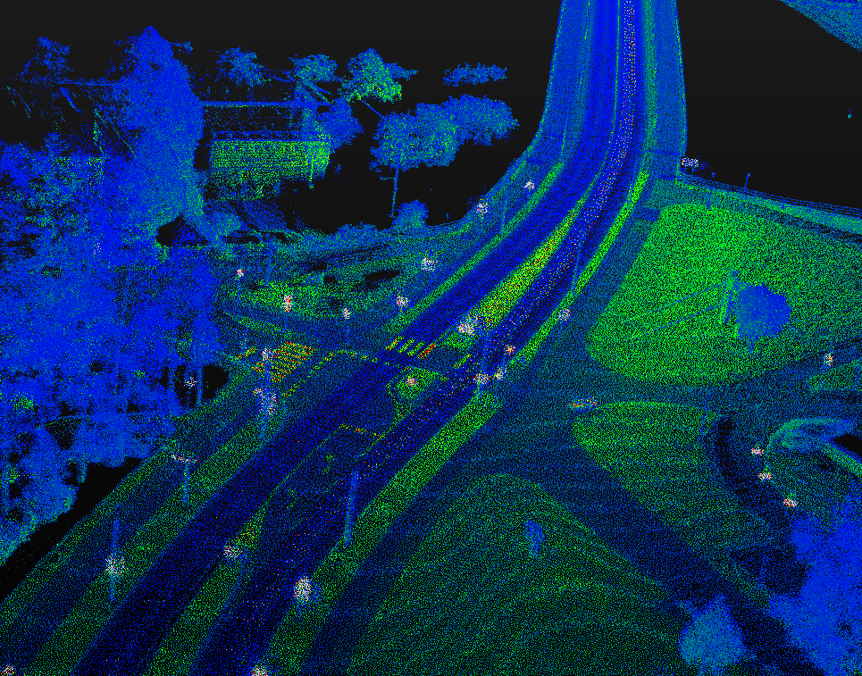
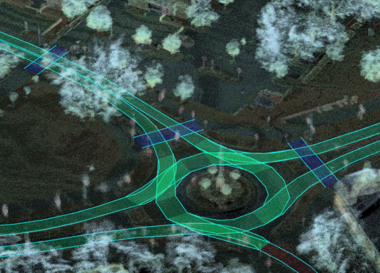

# `jkk_dataset_04` - mapping

## `2026-07-20` - Győr, Campus Point Cloud and Lanelet2 Map

Version `2026-07-20` (date in ISO 8601) of the LiDAR point cloud map and Lanelet2 map of the Széchenyi István University Campus (Győr, Hungary), captured on `2026-07-20`.

### Contents

`2026-07-20` version of the dataset contains:

- `pointcloud_map_2026_07_20.pcd` dense point cloud map generated from Ouster and Luminar LiDAR scans collected with a ROS 2 / MCAP-based mobile mapping platform.
- `lanelet2_map_2026_07_20.osm` semantic HD map in Lanelet2 format, aligned to the georeferenced point cloud, covering the Győr Campus test site.

### URL

- The point cloud was georeferenced and aligned, related map data and tools are available at: [github.com/jkk-research/lanelet2_maps](https://github.com/jkk-research/lanelet2_maps)
- JKK dataset landing page: [jkk-research.github.io/latest/dataset](https://jkk-research.github.io/latest/dataset)
- Zenodo DOI: [doi.org/10.5281/zenodo.21871328](https://doi.org/10.5281/zenodo.21871328) [](https://doi.org/10.5281/zenodo.21871328)
- Zenodo record: [zenodo.org/record/21871328](https://zenodo.org/record/21871328) 

### Download

Either from Zenodo: [https://doi.org/10.5281/zenodo.21871328](https://doi.org/10.5281/zenodo.21871328) or directly with `wget`:

```bash
wget -O pointcloud_map_2026_07_20.pcd  "https://zenodo.org/records/21871328/files/pointcloud_map_2026_07_20.pcd?download=1"
```
```bash
wget -O lanelet2_map_2026_07_20.osm  "https://zenodo.org/records/21871328/files/lanelet2_map_2026_07_20.osm?download=1"
```

Alternatively, use Autoware naming conventions (`pointcloud_map.pcd` and `lanelet2_map.osm` in a separate directory):

```bash
wget -O pointcloud_map.pcd  "https://zenodo.org/records/21871328/files/pointcloud_map_2026_07_20.pcd?download=1"
```
```bash
wget -O lanelet2_map.osm  "https://zenodo.org/records/21871328/files/lanelet2_map_2026_07_20.osm?download=1"
```

## Keywords

LiDAR, point cloud, georeferencing, Lanelet2, mobile mapping, autonomous driving, HD map

## Citation

If you use this dataset in your research, please cite the following:
```bibtex
@dataset{jkk_dataset_04,
  author       = {Horváth, Ernő and
                  Krecht, Rudolf and
                  Markó, Norbert and
                  Igneczi, Gergo and
                  Pusztai, Zoltán and
                  Kőrös, Péter and
                  Mesics, Mátyás and
                  Enisz, Krisztian and
                  Zahuczki, Zoltán and
                  Unger, Miklós and
                  Józsa, Dávid},
  title        = {jkk\_dataset\_04 mapping | HD map - Győr, Campus
                   2026-07-20
                  },
  month        = jul,
  year         = 2026,
  publisher    = {Zenodo},
  version      = {2026-07-20},
  doi          = {10.5281/zenodo.21871328},
  url          = {https://doi.org/10.5281/zenodo.21871328},
}
```

## Images

{width="80%"}
{width="80%"}